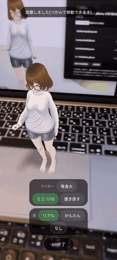

# XRoomCast

VRMアバターの動きを**数KB/sのポーズデータ**として配信し、
視聴者がURLを開くだけでリアルタイムに見られるシステムです。

動画を流さずポーズだけを送るため、**帯域は動画配信の1/100以下**で済みます。



## できること

**視聴する**

- ブラウザだけで見られます。PC / スマホ / HMD(Quest・PICO等)、インストール不要です
- AR/MRで現実の部屋にアバターを置けます。等身大でも1/10のミニサイズでも構いません
- 配信者の声がアバターの位置から聞こえ、声に合わせて口が動きます(空間オーディオ+リップシンク)
- 他の視聴者の気配が見えます(端末に応じてHMD・スマホ・PCの形で表示されます)
- 匿名でコメントを送れます

**配信する**

- VSeeFace等の**VMCトラッキング**(PC)か、**HMD単体**(VSeeFace不要)を選べます
- **複数の配信者が同じルームに並べます**(席が自動で割り当てられ、声もそれぞれの位置から聞こえます)
- 配信中にアバターをアップロードして切り替えられます。視聴者全員へ自動で同期されます
- 配信者コンソールで、視聴者に届いている姿と視聴者の位置を確認できます
- **視聴URLとQR**がコンソールに出ます。会場掲示用に全画面へ拡大できます
- ルームを分ければ、同時に複数の配信を立てられます

**使い分ける**

公開配信・非公開配信・イベント会場を、**別々に用意する必要はありません。**
配信者コンソールの設定を切り替えるだけです(デプロイし直し不要、視聴者にも即座に反映)。

- 視聴を**誰でも / 招待された人だけ**
- **同時に見られる人数の上限**(URLが出回ったときの課金の歯止め)
- コメントの可否、視聴者の位置の公開範囲
- **緊急停止**

<br clear="right" />

上の映像は、スマホのARで机の上に1/10サイズのアバターを置き、
配信中に衣装を切り替えているところです。
奥のPC画面が先に切り替わってAR側が遅れて追いつくのは仕様どおりで、
**視聴者ごとにダウンロードが終わった時点で差し替わる**ためです。

[フル版の動画(28秒)](./docs/ar-demo-full.mp4)

## ローカルで試す

Cloudflareのアカウントは要りません。VRMファイルを1つ用意してください。

```sh
npm install
# apps/viewer/public/avatar.vrm にVRMを置く
npm run dev
```

ブラウザで開くとアバターが待機モーションで立ちます。
「デモ再生」ボタンでダミーモーションを流せば、全身の動きも確認できます。

VSeeFace等でモーションを流す場合は、別ターミナルで `npm run bridge` を起動します。

## インターネットに公開する

Cloudflare上で動かします。必要なものは以下のとおりです。

| | 用途 |
|---|---|
| Cloudflareアカウント | R2を使うためクレジットカード登録が必要です |
| Workers | ビューアの配信とAPI |
| Realtime (SFU) | モーションと音声の中継 |
| R2 | VRMファイルの保管 |
| KV / Durable Objects | 配信状態・同接・コメント・視聴者の位置 |

**手順は [SETUP.md](./SETUP.md) にまとめてあります。**
Windowsなら `セットアップ.bat` をダブルクリックするだけの
**セットアップウィザード**(ブラウザ画面・ターミナル不要)で公開まで終わります。

> セルフホストの場合、**Cloudflareの請求はご自身に届きます。**
> 視聴URLが流出すると視聴者数とともに課金が伸びるため、
> 支出上限アラートの設定をおすすめします。

## ドキュメント

| | 内容 |
|---|---|
| [SETUP.md](./SETUP.md) | 動かすまでの手順。ローカル・公開・配信・トラブル対応 |
| [docs/アーキテクチャ.md](./docs/アーキテクチャ.md) | 全体像を掴むための1枚(構成図・データの流れ・逆引き) |
| [docs/実装メモ.md](./docs/実装メモ.md) | 実装の詳細と、そうしている理由 |
| [docs/今後の実装.md](./docs/今後の実装.md) | まだ着手していない構想と、採らなかった選択肢の記録 |

## 動作環境

| | 対応 |
|---|---|
| PC / Android | 視聴・AR ともに対応しています |
| iPhone / iPad | 視聴は対応。ARは [EyeJack X](https://play.eyejack.xyz/) 経由で表示できます |
| Quest / PICO 等のHMD | 視聴・AR/VR・**HMD単体での配信**に対応しています |
| 配信側(VMC) | VSeeFace, VMagicMirror など。Node.js 22以降が必要です |

## ライセンス

正式なライセンスは**現在検討中**ですが、**個人で試す分にはご自由にどうぞ。**

- ✅ 個人が非商用で試すこと(clone・ローカル実行・ご自身のCloudflareでの動作確認)
- ✅ 試している様子を撮影してSNS等で公開すること
- ✅ 本ソフトで撮った映像や配信を公開・利用すること
  (**成果物の権利は作成した方に帰属します**)
- ❌ 改変版・派生物の再配布
- ❌ 商用サービスとしての提供、企業・団体の業務での利用

❌の用途をご希望の場合や、判断に迷う場合は X のDM
([@ishiki_emo](https://x.com/ishiki_emo))までご連絡ください。
詳細は [LICENSE](./LICENSE) をご覧ください。

### 使用している主なオープンソース

いずれも各自のライセンスに従います(本リポジトリのライセンスとは別です)。

| パッケージ | ライセンス | 用途 |
|---|---|---|
| [three.js](https://github.com/mrdoob/three.js) | MIT | 3D描画・WebXR |
| [@pixiv/three-vrm](https://github.com/pixiv/three-vrm) | MIT | VRMの読み込み・表情・揺れもの |
| [ws](https://github.com/websockets/ws) | MIT | ブリッジのWebSocketサーバー |
| [osc-min](https://github.com/russellmcc/node-osc-min) | Zlib | VMC(OSC)のパース |
| [node-datachannel](https://github.com/murat-dogan/node-datachannel) | MPL-2.0 | ブリッジのWebRTC |
| [Vite](https://vitejs.dev/) / [TypeScript](https://www.typescriptlang.org/) / [Wrangler](https://developers.cloudflare.com/workers/wrangler/) | MIT / Apache-2.0 / MIT | ビルド・デプロイ |

## 作者

癒色えも (ISHIKI Emo) — [X (Twitter) @ishiki_emo](https://x.com/ishiki_emo)
