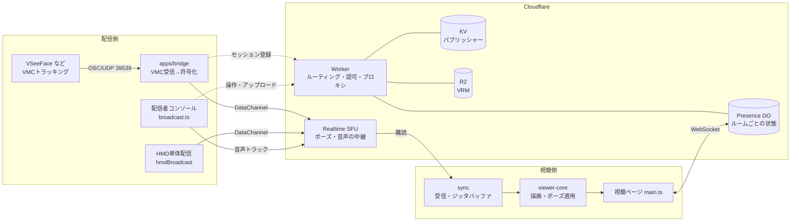
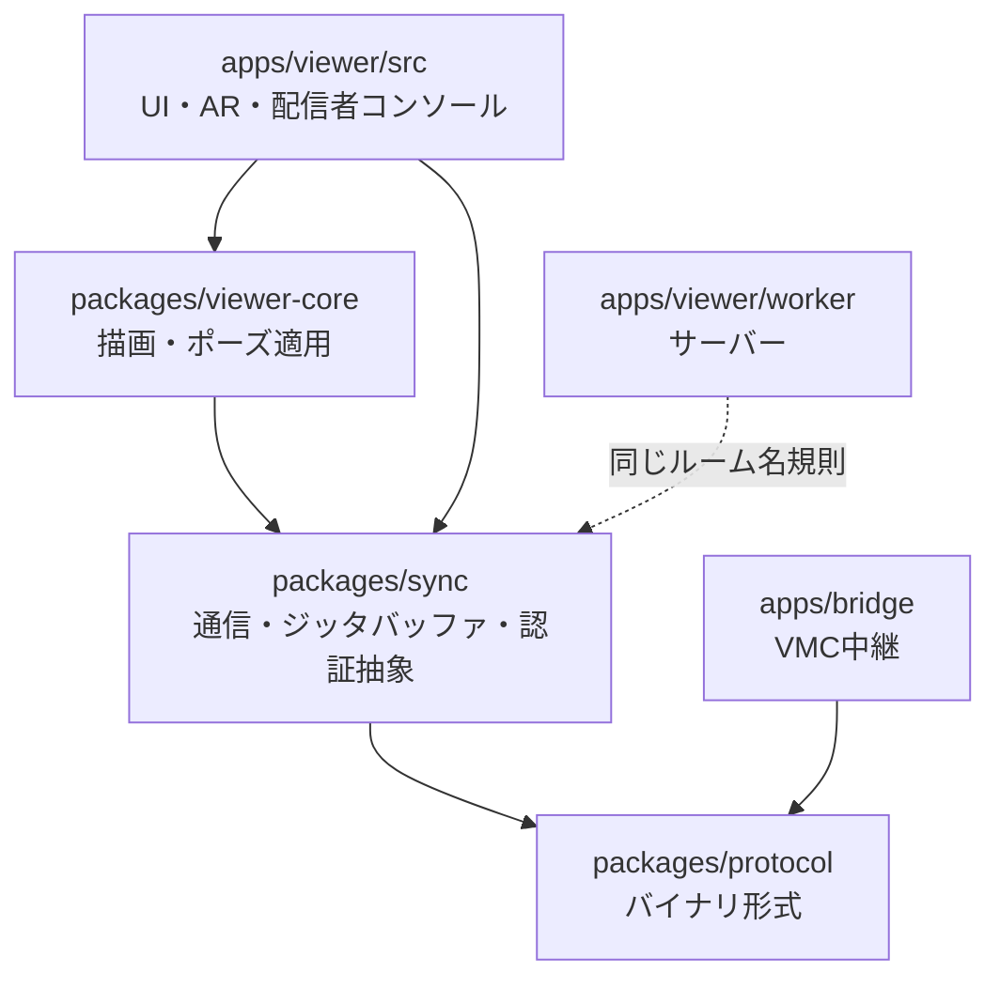
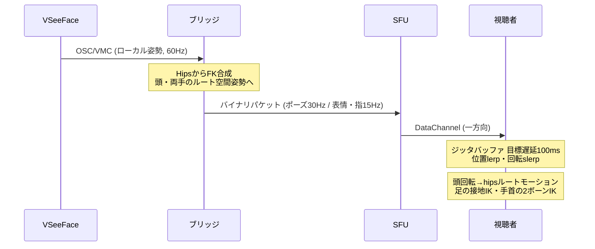

# アーキテクチャ地図

全体像を掴むための1枚。**機能ごとの詳細は [実装メモ.md](実装メモ.md)**、動かす手順は [../SETUP.md](../SETUP.md)。

このファイルは**短く保つ**のが目的なので、細部は書かない。

---

## 1. 何をするソフトか

VRMアバターの動きを**数KB/sのポーズデータ**として配信し、視聴者はURLを開くだけで見られる。
動画を送らないので帯域は動画配信の1/100以下。

想定する使い方は3つあり、**どれも同じコードで、設定だけで切り替える**のが方針。

| 使い方 | 認証 | 視聴者 |
|---|---|---|
| 公開配信 | なし | 見るだけ + コメント |
| 非公開配信 | 招待制 | 見るだけ + コメント |
| イベント会場 | なし | 気配を見せ合う(将来: 声も) |

---

## 2. 構成



**要点**

- **Cloudflareは前提ではない。** 同期の抽象は [transport.ts](../packages/sync/src/transport.ts) の十数行で、SFUはその1実装。WebSocket実装(ブリッジ直結)も実在して動く
- **秘密はブラウザに出ない。** SFUのApp Secretは Worker の中だけ。ビューアは Worker のプロキシ経由でSFUに繋ぐ
- **ブリッジは必須ではない。** HMD単体配信ならブラウザから直接SFUへ送る
- **配信者は1ルームに複数並べる**(サーバー上限8)。ストリームは**席番号(slot)**で識別し、
  席の割り当ては Presence DO が行う(配信元の自称ID = pid で同一性を判定)。
  視聴側は席ごとに表示ユニット(`AvatarUnit`)を立てる

---

## 3. パッケージ



| | 中身 | 依存 |
|---|---|---|
| `protocol` | ポーズのバイナリ形式 | **なし** |
| `sync` | トランスポート(WS / SFU)、ジッタバッファ、`AuthProvider`、ルーム名規則 | protocolのみ。**threeにも依存しない** |
| `viewer-core` | VRM読み込み、ポーズ適用、待機モーション、気配、空間音声、舞台 | three, three-vrm。**DOM要素には触らない** |
| `apps/viewer/src` | 画面のUI、AR/MR、配信者コンソール、席の表示ユニット(`avatarUnit.ts`)、URLクエリの解釈 | 上記すべて |
| `apps/viewer/worker` | ルーティング、認可、SFUプロキシ、Presence DO | なし |
| `apps/bridge` | VMC受信とSFUへの送出。**HMD配信では不要** | node系 |

---

## 4. データの流れ

### ポーズ(配信の本体)



**受信が途切れたら**待機モーションへブレンドする(サーバーからは何も送られない)。

複数配信者では配信者ごとにSFUセッションが分かれ、視聴側は席(slot)ごとの
DataChannelで受けて `AvatarUnit` へ振り分ける。音声トラックの席はSDPのmidで識別する。

### 状態の共有(Presence WebSocket)

視聴者と配信者は Presence DO へ WebSocket で繋ぎ、ここを通して以下がやり取りされる。

| 種別 | 向き | 内容 |
|---|---|---|
| `count` | → 全員 | 同時接続数 |
| `chat` / `history` | ⇄ | 匿名コメント(50件保持・1秒レート制限) |
| `peer` / `peerLeft` | ⇄ | 視聴者の気配(頭・手の位置、10Hz) |
| `peerMode` | → 全員 | 気配の公開範囲(旧互換。現在は `settings` に統合) |
| `publishers` | → 全員 | 配信者の顔ぶれ `[{slot, sessionId}]`(pidは配らない) |
| `avatar` / `avatarCleared` | → 全員 | 席ごとのアバターの切り替え / 席が空いた通知 |
| `audio` | → 全員 | 席ごとの音声の開始/停止(`{slot, audio}`、停止は `audio: null`) |
| `stage` | → 全員 | 舞台(背景)の切り替え |
| `settings` | → 全員 | ルーム設定(公開/招待制・コメント・上限・緊急停止・気配の公開範囲) |
| `admission` | → 本人 | 入室証。人数の判定を通ったことをSFUへ示すために使う |

**ポーリングはしない。** すべてサーバーからの押し出し。以前は音声を30秒間隔で問い合わせていたが、視聴者×1日2,880回になるため廃止した。

---

## 5. 状態がどこにあるか

```mermaid
flowchart TB
  subgraph 揮発しない
    R2[(R2: VRM本体<br/>rooms/{room}/*.vrm)]
  end
  subgraph ルームごと・接続が切れても残る
    DO[(Presence DO<br/>コメント履歴50件<br/>ルーム設定<br/>席割り当て pid→slot<br/>席ごとのアバター<br/>席ごとの音声パブリッシャー)]
  end
  subgraph 15分で失効・DOだけが書く索引
    KV[(KV<br/>publisher:{room} 席の配列<br/>audio-publisher:{room} 席の配列)]
  end
  subgraph 画面を閉じたら消える
    CL[クライアント<br/>URLクエリ由来の設定<br/>接続状態]
  end
```

**ルームの一覧はどこにも無い。** ルームのトークンは `HMAC(ROOM_SECRET, "用途:ルーム名")` で導出するので、いくつ作っても状態管理が要らない。その代わり**個別の失効ができない**(ローテートすると全ルームが無効になる)。

---

## 6. 認証・認可の差し替え点

**「誰が何をしてよいか」は2箇所にしかない。**

| | 場所 | 役割 |
|---|---|---|
| サーバー | [worker/auth.ts](../apps/viewer/worker/auth.ts) の `authorize()` | 判定。scope は viewer / broadcaster / publisher / vrm |
| クライアント | [src/auth.ts](../apps/viewer/src/auth.ts) の `createAuth()` | 資格情報をどこから取り、どう載せるか |

コア(`sync` / `viewer-core` / `protocol`)は認証を一切知らない。
独自の会員認証を載せる場合はこの2つを差し替えれば足りる。詳細は [実装メモ.md](実装メモ.md#認証認可の差し替え点)。

---

## 7. 逆引き: Xを変えたいときどこを触るか

| やりたいこと | 触る場所 |
|---|---|
| 認証方式を変える | `worker/auth.ts` の `authorize()` と `src/auth.ts` の `createAuth()` |
| 視聴を招待制にする | **配信者コンソールの「⚙️ ルーム設定」**(デプロイ不要)。`REQUIRE_VIEWER_TOKEN` は設定を持たないルームの既定値 |
| ルームごとの設定を足す | `RoomSettings`(worker/index.ts)+ `src/roomSettings.ts` にUI |
| ポーズの中身を増やす | `packages/protocol` → ブリッジの送出 → `poseApplier` |
| 別のサーバーで動かす | `packages/sync` の `Transport` を実装 |
| 席(複数配信者)の挙動 | 割り当て・片付けは `worker/index.ts` のPresence DO、視聴側の振り分けは `src/main.ts` + `src/avatarUnit.ts` |
| リップシンク | `packages/viewer-core/src/lipSync.ts`(口の所有は `src/avatarUnit.ts`) |
| 描画・見た目 | `packages/viewer-core`(舞台は `scenery.ts`) |
| AR/MRの挙動 | `apps/viewer/src/ar.ts` / `touchAR.ts` / `spatialUI.ts` |
| 配信者の操作画面 | `apps/viewer/src/broadcast.ts` と `avatarConsole.ts` |
| VMC(VSeeFace)の解釈 | `apps/bridge/src/vmcReceiver.ts` / `skeleton.ts` |

---

## 8. 決まっていること・いないこと

**決まっている**

- コアは同期と描画に分離し、UIと認証は載せる側が用意する
- サーバーからの押し出しを基本とし、クライアントのポーリングは置かない
- ルーム一覧は持たない(トークンはHMAC導出)
- 使い分けは**設定で行う**。公開配信・非公開配信・イベント会場を別物として作らない
- **視聴者の発話はプッシュトゥトーク**、既定オフ。会場では参加者が同じ物理空間に
  いるためハウリングが避けられず、常時オンだと運用が破綻する。押している間だけ
  送る形にすれば同時発話者数が自然に抑えられ、エグレス課金の面でも安全側に倒せる
  (イヤホンやHMD内蔵スピーカーの利用が前提でも、この判断は変えない)

**未決・保留**

| | 状況 |
|---|---|
| ライセンス・配布形態 | 検討中。npm公開の基盤はこれが決まってから |
| 招待の個別失効 | **できない。** 状態を持たない設計とのトレードオフ(入室証と同じ仕組みで作れる見込み) |
| 視聴者の発話 | 未実装(方式はプッシュトゥトークで決定)。空間音声の複数音源化・席ごとの音声パブリッシャーは実装済みで、残るのは視聴者側の送話UIと同時発話者数の上限 |
| `viewer-xr` の切り出し | 未着手。AR層はDOM要素を受け取る前提があり、公開APIの形に検討が要る |
| 音声の遅延 | 十数回に一度大きくなることがある(リロードで回復)。`getStats()` での実測待ち |
